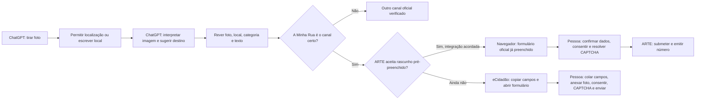

# eCidadão → A Minha Rua: desenho da passagem para o portal oficial

## Resultado pretendido

No telemóvel, a pessoa começa no ChatGPT, tira uma fotografia, confirma o local e revê uma ocorrência curta. Toca em **Abrir A Minha Rua**. O navegador mostra o formulário oficial com local, categoria, assunto, descrição, fotografia e identificação já carregados. A pessoa revê os dados, aceita a divulgação à autarquia, resolve o CAPTCHA e toca em **Enviar Ocorrência**. O número da ocorrência vem da ARTE, nunca do eCidadão.

Este último ecrã **ainda não é possível com a integração atual**. O site da ARTE não expõe uma ligação de pré-preenchimento documentada nem uma API pública de submissão. Abrir o formulário num navegador não dá ao plugin permissão para escrever nos seus campos. O formulário atual usa estado de sessão ASP.NET, seleções dependentes de distrito/município/freguesia, upload de ficheiro, consentimento e reCAPTCHA.

## Percurso visual



### Ecrã 1 — ChatGPT

```text
┌──────────────────────────────────────────┐
│ eCidadão                                  │
│ [ fotografia do problema ]                │
│                                          │
│ 📍 Usar localização     ou     Escrever   │
│ «Rua Alfredo Cunha, Matosinhos»           │
│ [ Confirmar local ]                       │
└──────────────────────────────────────────┘
```

Só se pede localização precisa depois de a pessoa tocar no botão. A fotografia não prova, por si só, a morada ou a entidade responsável. A rua e a autarquia são confirmadas pela pessoa; se a autarquia não aderiu ao A Minha Rua, o cartão encaminha para outro canal verificado.

### Ecrã 2 — Revisão no ChatGPT

```text
┌──────────────────────────────────────────┐
│ Reporte para A Minha Rua                  │
│ Foto: [miniatura]                         │
│ Local: [rua] · [freguesia] · [município]  │
│ Categoria: [categoria oficial]            │
│ Assunto: [curto e editável]               │
│ Descrição: [factos observáveis]           │
│                                          │
│ Nome: [preencher]  Email: [preencher]     │
│ [ Corrigir ]  [ Abrir formulário oficial ]│
└──────────────────────────────────────────┘
```

Mostrar que a morada e a descrição ficam públicas no portal. Não colocar dados pessoais na descrição. O nome e o email são pedidos apenas quando o canal escolhido os exigir. O telefone é facultativo. O botão não equivale a enviar a ocorrência.

### Ecrã 3 — Navegador

**Percurso alvo, dependente da ARTE:** o formulário oficial abre com os dados e a foto carregados. A pessoa revê, autoriza a divulgação dos dados à autarquia, resolve o CAPTCHA e envia. Só depois de uma resposta oficial mostramos «Enviado» e o identificador.

**Percurso disponível sem integração:** uma página de passagem do eCidadão apresenta os campos separados com ações **Copiar assunto**, **Copiar descrição** e **Abrir A Minha Rua**; a pessoa seleciona o local, cola o texto, anexa a foto, identifica-se, consente e resolve o CAPTCHA no portal. Esta página deve dizer «Rascunho; ainda não enviado».

## Contrato de pré-preenchimento a propor à ARTE

Precisamos de um mecanismo **oficial** para criar um rascunho e abrir o formulário com ele. A forma sugerida é:

1. Depois da revisão e autorização da pessoa, o eCidadão envia à ARTE local, categoria, assunto, descrição, fotografia e dados de contacto por uma integração autenticada.
2. A ARTE devolve uma ligação de uso único para o seu formulário, com validade curta. A ligação contém só um identificador opaco, não dados pessoais na URL.
3. A ARTE carrega o rascunho na sessão do formulário. A pessoa revê, consente, faz o CAPTCHA que a ARTE exigir e envia no domínio oficial.
4. A ARTE mostra o número da ocorrência. Um retorno autenticado ou uma consulta documentada permitiria ao eCidadão mostrar o mesmo número; sem isso, pedimos à pessoa que o guarde.

O contrato deve definir a lista de autarquias e categorias aceites, limites e formatos de imagem, correções no formulário, expiração do rascunho, prevenção de duplicados, estado de erro e conservação dos dados. Nenhum destes endpoints foi fornecido pela ARTE; estes passos são uma proposta, não uma integração existente.

## Dados e fronteiras

| Dado | Origem | Antes da confirmação | Após «Abrir formulário oficial» |
| --- | --- | --- | --- |
| Fotografia | Câmara/ficheiro escolhido no ChatGPT | Visível à pessoa e ao ChatGPT para análise | Só enviada ao eCidadão/ARTE se a pessoa autorizar a entrega; não incluir dados de terceiros desnecessários |
| Coordenadas | Permissão do dispositivo | Usadas para sugerir um local; a morada é confirmada | Partilhar só o local necessário para o reporte |
| Texto e categoria | ChatGPT + edição da pessoa | Rascunho corrigível | Copiados pela pessoa ou entregues à ARTE via integração acordada |
| Nome e email | Pessoa | Pedido tardio, sem sugerir valores | Introduzidos no portal oficial ou entregues via integração acordada |
| Comprovativo | ARTE | Inexistente | Só aparece após confirmação oficial de envio |

Para uma passagem entre ChatGPT e navegador, um rascunho temporário do eCidadão pode usar um identificador aleatório de uso único, expirar em 15 minutos e nunca pôr foto, coordenadas ou identificação na URL. Não implementar esta passagem até haver autenticação/limites de acesso, política de retenção e um destino real para o rascunho. O estado do widget ChatGPT não serve como armazenamento duradouro nem como prova de submissão.

## Regras de conclusão

- No percurso atual, **Abrir A Minha Rua** nunca mostra «Enviado» e nunca promete formulário pré-preenchido.
- No percurso alvo, os campos e a fotografia aparecem no domínio oficial antes de o utilizador consentir ou enviar; o CAPTCHA e o botão final ficam no portal da ARTE.
- Se a ARTE rejeitar um campo, imagem ou autarquia, o utilizador vê o erro no formulário e consegue corrigir sem perder os restantes dados.
- A aplicação só mostra o número da ocorrência recebido da ARTE ou copiado do comprovativo pela pessoa.
- O percurso é testado num telemóvel real, na app ChatGPT e no navegador que ela abre, antes de ser anunciado como disponível.

Fontes: [documentação oficial da UI de plugins ChatGPT](https://developers.openai.com/plugins/build/chatgpt-ui), [referência oficial da ligação `openExternal`](https://developers.openai.com/plugins/reference), [formulário e ajuda A Minha Rua](https://servicos.arte.gov.pt/Portal/AMR/situationReport.aspx), [termos da ARTE](https://www.gov.pt/termos-e-condicoes/termos-e-condicoes-a-minha-rua).
